# Sai Vamshi

**I build web tools that help teams find information and spend less time on manual work.**

Software engineer · Backend systems, web applications, and AI workflows

[Choose a route](#case-files) · [Project index](#project-index) · [Contact](#contact)

---

## Case files

Open a route to see the decision behind the project.

<strong>01 · SEARCH — What if two reports describe the same incident differently?</strong>

On-call engineers can search past incidents and review suggested next steps in one place.

**Inside the build** · The service combines keyword search with semantic similarity so it can find related incidents even when the wording changes.

`Python` · `FastAPI` · `Redis` · `React` · [OpsSage AI source](https://github.com/saivamshi4121/opssage_ai)

<strong>02 · VALIDATE — What if the model returns an invalid answer?</strong>

The agent sorts support tickets and returns a usable result even when a model response fails validation.

**Inside the build** · Validate the response, retry on failure, and return an explicit `unknown` category if the retry fails too.

`TypeScript` · `Node.js` · `Zod` · `Claude` · [Support Triage Agent source](https://github.com/saivamshi4121/Support-Triage-Agent)

<strong>03 · QUEUE — What if a task can run outside the web request?</strong>

Instructors can draft courses and quizzes, while students can discover lessons and track progress.

**Inside the build** · BullMQ and Redis support background jobs in the Node.js backend.

`Next.js` · `Express` · `PostgreSQL` · `BullMQ` · `Gemini` · [LearnOrbit source](https://github.com/saivamshi4121/learnorbit)

<strong>04 · REDIRECT — What if a printed QR code needs a new destination?</strong>

A dynamic QR code can point to a new destination after printing. Its dashboard also tracks scans by device and location.

`Next.js` · `MongoDB` · `Cloudinary` · [Qrezo / QRify source](https://github.com/saivamshi4121/QRify)

## Project index

- **Blockchain** · [SkillVerse Backend](https://github.com/saivamshi4121/skill-verse-backend) · [Algorand Python Assignment](https://github.com/saivamshi4121/algorand-python-coding-assignment)
- **Developer tools and education** · [Node-Based Editor](https://github.com/saivamshi4121/Node-Based-Editor) · [ProjectPilot](https://github.com/saivamshi4121/ProjectPilot) · [StudyTrackr](https://github.com/saivamshi4121/StudyTrackr)
- **Community and events** · [Swayamsevak Connect](https://github.com/saivamshi4121/swayamsevak_connect_frontend) · [TheEventzy](https://github.com/saivamshi4121/eventzy) · [Ambulance Alert System](https://github.com/saivamshi4121/AMBULANCE-PROJECT)
- **More work** · [Portfolio source](https://github.com/saivamshi4121/vamshi_portfolio) · [All public repositories](https://github.com/saivamshi4121?tab=repositories)

**Working with** · Python, TypeScript, JavaScript · FastAPI, Node.js, Express · React, Next.js · PostgreSQL, MongoDB, Redis  
**Exploring** · How to measure whether an AI fallback helps and how to find related incidents when their descriptions differ.

## Contact

Building something around backend systems, developer tools, or AI workflows? [Connect on LinkedIn](https://linkedin.com/in/saivamshi-webdev) or [email me](mailto:palamurivamshi2005@gmail.com).
